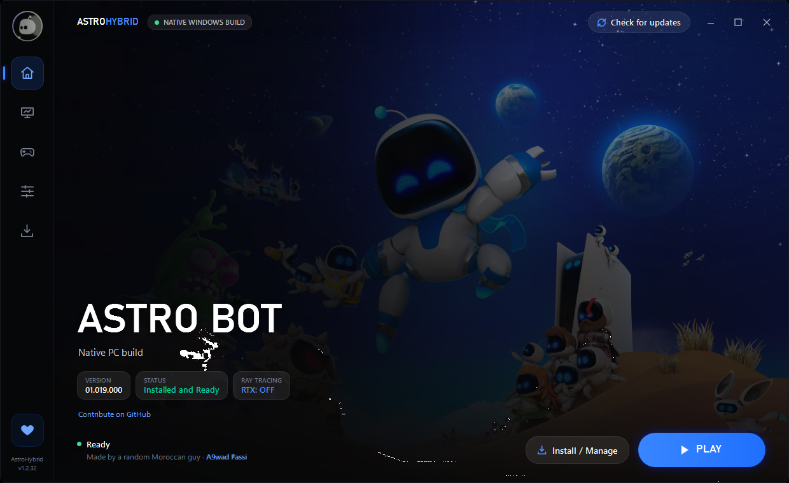

# Astro Bot native PC port (AstroHybrid): DLSS Frame Generation, Reflex, any controller


A personal research project: running my own legally owned PS5 copy of **Astro Bot** (PPSA21567, v01.019.000)
natively on Windows, with NVIDIA DLSS Super Resolution, DLSS (Multi) Frame Generation and Reflex added on top.

**No game files are in this repository or in the download**, and none will be: no game executable, assets,
shaders, keys, saves or game artwork. You need your own decrypted dump of the game; the setup converts it on your PC.

## Download and play

1. Download the **AstroBotPC-AstroHybrid** zip from the [latest release](https://github.com/imnotsharingmyname/pcportastrobot/releases/latest)
   and extract it anywhere with about 1 GB free (the game itself stays where your dump is).
2. Start **AstroHybrid.exe**. Setup asks for your Astro Bot dump folder, the one with `eboot.bin`, `sce_module`
   and `sce_sys` (Browse, or paste the path and press Check folder), then Install. It builds the Windows version
   of the game from the dump in about two minutes. Your dump is only read, never changed.
3. The app picks the best settings for your PC once (graphics card, CPU, RAM, display); change anything on the
   Graphics, Controller and Advanced pages.
4. Press **Play**.

The download is the same build as the development PC: the same PS5 system libraries, `kyty_gpu.dll` (DLSS,
frame generation, Reflex, controller fixes), the same launcher settings, and setup makes the same `AstroBot.exe`
byte for byte from a 01.019.000 dump. Other Astro Bot versions are accepted: the faster-lighting patch and
real-time game speed switch themselves off when that version's code differs (they depend on exact code
locations); everything else works the same way. Only 01.019.000 has been tested.

Requirements: Windows 10/11 x64 ([Linux: see below](#linux-wine)), a Vulkan GPU; DLSS needs an RTX card, frame generation an RTX 40 or 50.
Controllers: DualSense, DualShock 4, Xbox, Switch Pro and compatible pads, generic pads (the one you press plays).
Command line: `AstroHybrid.exe --setup "<dump folder>"` runs the setup without a window; `--remove-game` removes
what setup built.

### Linux (Wine)

The same download runs on Linux under Wine 11 or newer (Proton's wine works too). This is community-tested,
not officially supported. No winetricks are needed for the game.

1. Extract the zip as above.
2. Run setup with your dump folder (about a minute):
   ```sh
   ./Run-AstroHybrid-Linux.sh --setup "/path/to/Astro Bot dump"
   ```
3. Play:
   ```sh
   ./Run-AstroHybrid-Linux.sh
   ```

The script uses your default Wine prefix; set `WINEPREFIX` to use another one. It starts the game through
`Run-AstroHybrid.bat`, so the game gets the same defaults as on Windows.

| To... | Do this |
|---|---|
| Change resolution or other settings | Set the variables before the script, e.g. `KYTY_GPU_WIDTH=2560 KYTY_GPU_HEIGHT=1440 KYTY_GPU_FULLSCREEN=1 ./Run-AstroHybrid-Linux.sh` |
| Use the AstroHybrid app instead | `./Run-AstroHybrid-Linux.sh --launcher` (first install `winetricks dotnet48 corefonts` in the prefix) |
| Get rumble on a Bluetooth DualSense | Nothing: the script fixes the device entry Wine creates, so rumble, haptics and the light bar work (#59). `ASTROHYBRID_DS_BT_FIX=0` turns this off |
| Add frame generation | `ASTROHYBRID_LSFG=2` (or `3`, `4`) with [lsfg-vk](https://github.com/PancakeTAS/lsfg-vk) 2.x and Lossless Scaling from Steam on its `lsfg-vk` beta branch (#21) |
| Use gamescope or MangoHud | Wrap the script: `gamescope -f -- ./Run-AstroHybrid-Linux.sh` |
| See all options | `./Run-AstroHybrid-Linux.sh --help` |

DLSS and Reflex have not been tested under Wine.

### Screenshots

| Home | Graphics |
|---|---|
|  |  |
| **Controller** | **Advanced** |
|  |  |

## What it is

This is **not an emulator**. It is a native port:

- **AnyPS5** relinks the game's own x86-64 code into a Windows `.exe` (`AstroBot.exe`). The PS5 system
  libraries (kernel, libc, pad, audio, save data and so on) are reimplemented natively as Windows modules.
- **AstroHybrid**: the PS5 GPU side (AGC command buffers, shaders, VideoOut) is handled by a GPU stack taken from
  KytyPS5 and built as `kyty_gpu.dll`. It translates the GPU work to Vulkan and is loaded by the native exe.
- **NVIDIA RTX layer** (new): the game's own temporal upscale pass is found at run time and its inputs (colour,
  depth, motion vectors, jitter, camera matrices) are handed to DLSS and to DLSS Frame Generation through
  NVIDIA Streamline 2.14.16 on Vulkan.

## Benchmarks (real measurements, one PC)

Ryzen 5 5500 (6 cores / 12 threads), RTX 5060 8 GB, 32 GB RAM, 2560x1440 165 Hz, NVIDIA driver 621.

| What | Result |
|---|---|
| Sky Garden (heaviest area found), game's own frame rate | **32-34 FPS** uncapped; a 30 FPS cap holds in every 10 s window |
| Other levels (start positions) | Hoover beach 51-53, snowy canyon 43-44, Cymbal party land 37-39 FPS |
| Frame Generation 2x (window focused) | exactly 2.00 frames shown per game frame, about **63 FPS on screen** |
| Multi Frame Generation 4x | exactly 4.00 per game frame, about **124-128 FPS on screen** |
| Adaptive Frame Generation (target 60) | game held at 24 FPS: switches itself to 3x = 72 on screen; game at 30: 2x = 60 |
| "Faster CPU path" (commit epoch fast path) | about 0.3 us less per continued draw, roughly **1 ms of command-processor time per frame**; verify mode: 0 mismatches |
| Real-time game speed | the game ran at 0.50x speed when capped at 30 FPS; now **0.98x** real time |
| DLSS Super Resolution | runs every frame on the game's 1920x1080 -> 2432x1368 upscale pass, picture correct |

Where the time goes: a 30 ms frame is about 22 ms of draw commit on one CPU thread (about 4,900 draws a frame),
so the game is **CPU-limited**; the GPU has headroom. That is why Frame Generation is the main smoothing tool
here, and why lowering the resolution does not raise the frame rate.

Tried and rejected (measured): AVX2 build of the GPU DLL (no difference), write-fault window and lock-spin
tuning (within noise), Lossless Scaling x2 (stutter and input lag), AnyPS5's own renderer instead of Kyty's
(does not boot). Every result, good or bad, is in `Docs/OVERNIGHT.md`.

Caveat: numbers move with background load. With a browser playing audio the same 30 FPS-capped scene read
22-25 FPS in one evening session, so compare runs on a quiet machine.

## Features

What changed in each version is in the [release notes](https://github.com/imnotsharingmyname/pcportastrobot/releases).

- **DLSS Super Resolution** (`ASTROHYBRID_DLSS=1`). Needed a fix in AnyPS5's libc: CUDA (which DLSS uses) needs
  a 48 GiB address window below 1 TiB, which the PS5 memory map had taken (`ASTROHYBRID_CUDA_HOLE=1`).
- **DLSS Frame Generation and Multi Frame Generation** through Streamline (`ASTROHYBRID_DLSSG=1`,
  2x / 3x / 4x), with an **adaptive mode** that picks the multiplier in game every half second to stay at or
  above a target on screen (`ASTROHYBRID_DLSSG_TARGET`). The game itself is never capped below 30 FPS.
- **NVIDIA Reflex** for Vulkan through `VK_NV_low_latency2` (`ASTROHYBRID_LOW_LATENCY=1`).
- **Cloth and bubble stability** (`KYTY_BUFFER_RANGE_FIXES=1`, `ASTROHYBRID_COMMIT_EPOCH_FASTPATH=0`, plus 60 Hz cloth physics step cap during real-time speed below 60 FPS; issues #30, #35).
- **Performance overlay** shows frames on screen and the game's own rate with Frame Generation.
- **Controllers**: DualSense (rumble, light bar, adaptive triggers, motion), Xbox, Switch Pro and compatible
  pads, generic pads. The pad you press becomes player 1 (before, a second pad got no input), vibration
  strength for non-DualSense pads, a stronger-rumble option for third-party Switch-style pads.
- **Ultrawide**: 21:9 (2560x1080, 3440x1440) and 32:9 (5120x1440), each with a matching render variant (#58).
- **The AstroHybrid app** (`AstroHybrid.exe`, source in `AstroHybrid.App`):
  - setup from your dump, plus repair and uninstall on the Installation page;
  - Graphics page: resolution, NVIDIA upscaling, frame generation (Off / Auto / 2x / 3x / 4x), on-screen
    target, Reflex; Controller page: controller choice and vibration strength;
  - **"Best settings for this PC"**: reads the graphics card, CPU, RAM and display and fills in everything,
    also on first start. RTX 50: DLSS + Frame Generation Auto (x2-x4) to 120 on a 120 Hz+ display;
    RTX 40: Auto to 60 (x2); RTX 20/30: DLSS + Reflex at a steady 30; others: the game's own upscaling at 30;
  - real-time game speed and the faster CPU path are always on;
  - checks GitHub for new releases and updates itself.

All of this is behind environment switches that are off by default; the app turns them on.

### Two graphics cards (laptops)

A laptop with Intel or AMD integrated graphics plus an NVIDIA card (Optimus / hybrid) used to show only the
integrated chip, so the RTX options stayed off. The app lists every adapter, not only the one that drives
the screen:

- **Graphics page → Display → Graphics card**: "Automatic - best graphics card" (default) or a named card.
  DLSS, Frame Generation and Reflex follow the card you pick; picking a non-RTX chip turns them off.
- The renderer itself already prefers a discrete card, so Automatic is right for almost everyone. Pick the
  integrated chip only to compare performance.
- "Best settings for this PC" reads the discrete card on these laptops too.

## Requirements for the NVIDIA features

- DLSS Super Resolution and Reflex: any RTX card. Frame Generation: RTX 40 or newer; 3x and 4x: RTX 50.
- The download includes the Streamline 2.14.16 and DLSS runtime files, unmodified, under NVIDIA's licences in
  `licenses/`. They are not in this repository: a build from source needs them from NVIDIA, next to the game
  (`ASTROHYBRID_DLSS_PATH`).
- Frame Generation runs only while the game window is focused. Do not combine it with NVIDIA Smooth Motion.
- Only whole multipliers: NVIDIA's dynamic (fractional) multiplier is D3D12-only.

## Known issues

- Xbox and other pads without motion sensors: the motion hand does not work yet (tilt emulation with
  View/Back + right stick reaches the pad library but the game did not react in the user's test).
- Vibration on third-party Switch Pro pads (for example Data Frog) is not confirmed yet.
- With **no FPS limit and Frame Generation off**, the first loading screen stays black for about 35 s (it
  runs at about 144 FPS and slows the loading threads); capped starts take about 20 s. It is not a hang.
- Input latency with Frame Generation has not been measured. The DLSS jitter sign is set by eye.
- The game is CPU-limited at about 30-34 FPS on a Ryzen 5 5500 in the heaviest areas.

## What is here

| Folder | Contents |
|---|---|
| `Source/README.md` | Which public base and patch series each program file in the download is built from |
| `Source/anyps5` | AnyPS5 patch series for the PS5 libraries, `astrohybrid_host.dll` and the relinker (native libraries, AstroHybrid host, DualSense input/rumble/triggers/motion, CUDA address window) |
| `Source/kyty-hybrid` | KytyPS5 patch series for `kyty_gpu.dll` (frame pacing, real-time speed, fast path, Reflex, DLSS, Frame Generation, overlay, controllers) |
| `Source/patches`, `Source/hybrid/patches` | Earlier versions of the two series above, kept for history |
| `Source/game-patches` | Small optional byte patches applied at load time (lighting mode, GI probes, fixed 1080p) |
| `Source/experiments` | Measured experiments that were not kept, with their patches |
| `Tools/hybrid` | Classic launcher (no longer shipped), run-folder builder, Kyty build script, reverse-engineering helpers |
| `Tests` | Benchmarks and A/B test scripts |
| `Docs` | Build instructions, technical plans, reverse-engineering notes, and the full results log (`OVERNIGHT.md`) |
| `Run-AstroHybrid*.bat` | Start scripts: plain, DLSS, Frame Generation |
| `Run-AstroHybrid-Linux.sh` | Setup and start under Wine on Linux (see [Linux](#linux-wine)) |
| `AstroHybrid.App` | The AstroHybrid app (WPF, .NET Framework 4.8): setup from a dump (`Services/GameSetup.cs`, a C# port of AnyPS5's `unwrap_self.py`), settings, best settings for the PC, launch |
| `Tools/release` | `make_release.ps1` builds the download from a working install (with a guard against game files); `make_icon.ps1` draws the app icon |

## Status

Work in progress, personal use. Not affiliated with or endorsed by Sony Interactive Entertainment, Team ASOBI
or NVIDIA. Astro Bot is a trademark of its owners; NVIDIA, DLSS and Reflex are trademarks of NVIDIA.


REMOVE WHATS UNDER THIS WHEN YOU ACCEPT THE PULL REQUEST AND I DID NOT UPDATE IT TO 1.2.10 SO ITS 1.2.9 

- CHANGELOG

New: Stability Mode

Graphics > Advanced Settings now includes Stability Mode, enabled by default.

Stability Mode applies a set of conservative runtime settings intended to reduce random crashes, freezes and graphics synchronization problems:

- Enables safer GPU barrier batching.
- Disables dispatch overlap and draw-run optimizations.
- Disables several experimental fast paths and drawing optimizations.
- Enables command-buffer watermark monitoring.
- Enables the Kyty and AstroHybrid hang watchdogs.
- Applies a conservative graphics draw-slicing limit.
- Preserves existing user path overlays ("APS5_PATH_OVERLAYS").

These settings are applied automatically when Stability Mode is enabled. Turn it off to restore the normal runtime behavior.

New: 24 MiB Command Buffer option

Advanced Settings > Stability now includes an optional 24 MiB Command Buffer toggle.

- Stability Mode must be enabled for this option to work.
- Disabled by default.
- Increases the command-buffer allocation from 16 MiB to 24 MiB when the expected executable pattern is found.
- If the expected pattern is not found, the launcher skips the change instead of blindly modifying executable data.

This provides additional command-buffer headroom for games that produce large graphics workloads.

Stability and launcher changes

The launcher applies the command-buffer changes before starting the game and activates the selected stability settings.

The Stability Mode environment overrides are also applied by "Run-AstroHybrid.bat", while preserving existing path-overlay configuration.

Known issues

These changes are intended to improve stability, but they are not guaranteed fixes for every crash.

The "lost device" error 321 is not confirmed fixed.

Random freezes and graphics command-buffer exhaustion may still occur.

The 24 MiB option only applies when the expected executable pattern is found.

No Windows build verification or in-game testing was performed for these source changes, so performance and stability improvements still need testing.
