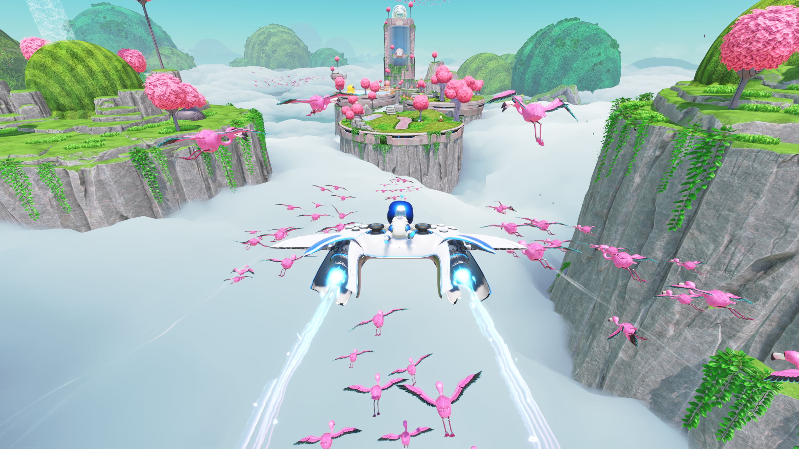
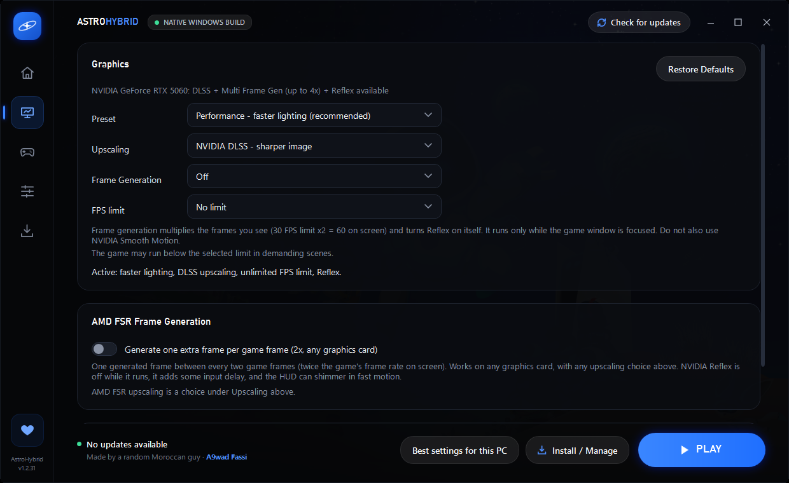
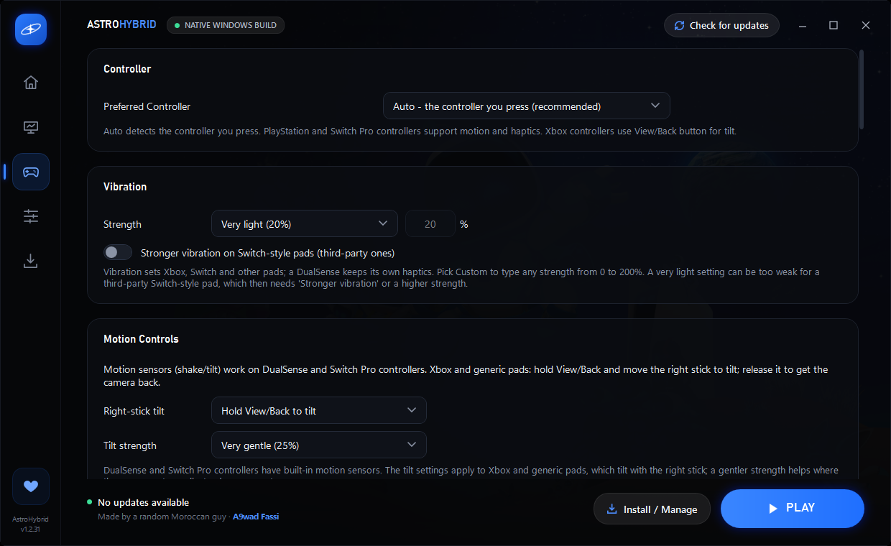
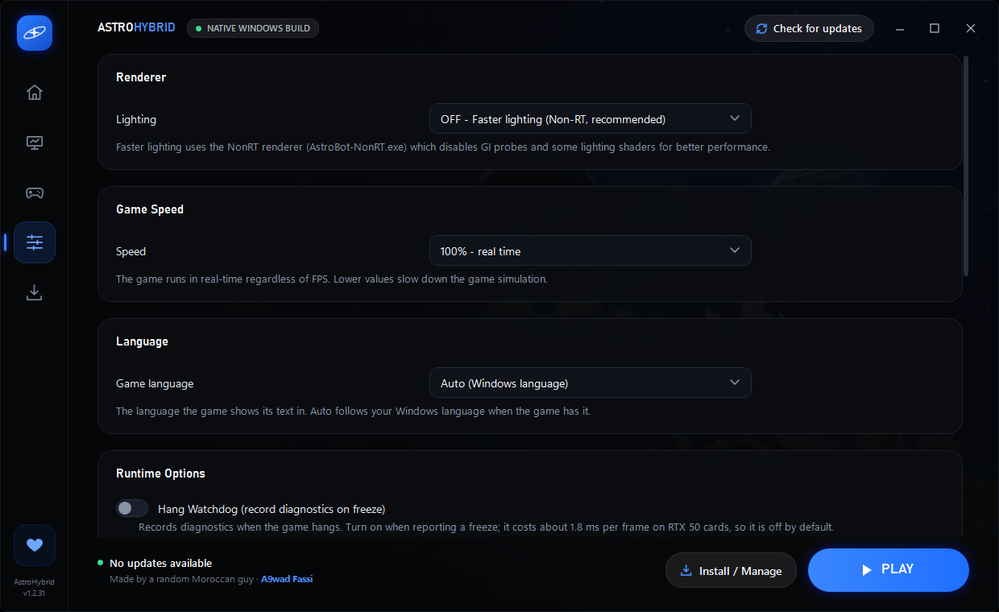

# Astro Bot — Native PC Port (AstroHybrid)

A native Windows port of **Astro Bot** (PPSA21567, v01.019.000) with **60+ FPS** support, **NVIDIA DLSS Super Resolution**, **DLSS (Multi) Frame Generation**, **NVIDIA Reflex**, and full controller support.

**No game files are in this repository or in the download**, and none will be: no game executable, assets, shaders, keys, saves, or game artwork. You need your own legally owned decrypted dump of the game; the setup converts it locally on your PC.

## How It Works

This is **not an emulator** — it is a native PC port:

- **AnyPS5:** Relinks the game's original x86-64 code directly into a native Windows executable (`AstroBot.exe`), with PS5 system libraries (kernel, libc, audio, controller input, save data, etc.) implemented natively on Windows.
- **Vulkan Graphics Translation:** Translates the game's native PS5 graphics command buffers and shaders directly to **Vulkan** on Windows, with **NVIDIA DLSS Super Resolution**, **DLSS Frame Generation**, and **NVIDIA Reflex** integrated on top.

## Download and Play

1. Download the **AstroBotPC-AstroHybrid** zip from the [latest release](https://github.com/imnotsharingmyname/pcportastrobot/releases/latest) and extract it anywhere with ~1 GB free (your game dump stays where it is).
2. Run **AstroHybrid.exe**. Select your Astro Bot dump folder (`eboot.bin`, `sce_module`, `sce_sys`) and click **Install** — setup builds the Windows version locally in about two minutes without modifying your dump.
3. On first launch, the app automatically detects your CPU, GPU, RAM, and display and applies the best settings for your PC. You can customize anything on the **Graphics**, **Controller**, and **Advanced** pages.
4. Click **Play**.

Other Astro Bot versions are accepted (only v01.019.000 has been fully tested).  
Command line: `AstroHybrid.exe --setup "<dump folder>"` runs setup headless; `--remove-game` removes what setup built.

## What You Need for 60 FPS

### 60+ FPS with DLSS Frame Generation (Recommended)
- **OS:** Windows 10 / 11 (64-bit)
- **CPU:** 6-core / 12-thread modern processor (e.g., Ryzen 5 5600 / Core i5-12400 or better)
- **GPU:** NVIDIA RTX 40-series or RTX 50-series (8 GB+ VRAM)
- **RAM:** 16–32 GB

### 60 FPS Native (without Frame Generation)
- **OS:** Windows 10 / 11 (64-bit)
- **CPU:** 8-core / 16-thread high single-thread processor (e.g., Ryzen 7 7700X / 7800X3D or Core i7-13700K+)
- **GPU:** Vulkan 1.3 GPU, RTX 4060 Ti / 5060 or better (with DLSS Quality/Balanced for 1440p)
- **RAM:** 32 GB recommended

### Minimum (30 FPS)
- **OS:** Windows 10 / 11 (64-bit)
- **CPU:** 6-core / 12-thread modern processor
- **GPU:** Vulkan 1.3 capable GPU (8 GB VRAM recommended)
- **RAM:** 16 GB

**Controllers:** DualSense (rumble, light bar, adaptive triggers, motion sensors), DualShock 4, Xbox, Switch Pro and compatible pads, and generic pads (whichever pad you press becomes Player 1).

## Screenshots

### Gameplay

### Launcher
| Home | Graphics |
|---|---|
|  |  |
| **Controller** | **Advanced** |
|  |  |

## Features & Progress

- **60+ FPS** with DLSS Frame Generation (2x) and **120+ FPS** with Multi Frame Generation (4x) on RTX 50-series GPUs, plus **Adaptive Frame Generation** to lock onto your target frame rate.
- **NVIDIA DLSS Super Resolution** on any RTX GPU and **NVIDIA Reflex** low-latency support.
- **Real-time game speed:** Full real-time game speed at any frame rate (no slow motion below 60 FPS), with stable cloth and physics simulation.
- **Built-in performance overlay** showing both on-screen FPS and native game FPS.
- **Laptop / Hybrid GPU support:** Automatically detects discrete GPUs on Optimus / dual-GPU laptops and lets you pick your adapter in Graphics settings.
- **Full controller support:** DualSense haptics, adaptive triggers, light bar, and gyro/accelerometer motion; customizable vibration strength for Xbox, Switch Pro, and third-party controllers.

## Notes on NVIDIA Features

- **DLSS Super Resolution & Reflex:** Any NVIDIA RTX GPU.
- **DLSS Frame Generation:** RTX 40-series or newer (3x / 4x requires RTX 50-series).
- Frame Generation is active while the game window is focused. Do not combine it with NVIDIA Smooth Motion.

## Known Issues

- Motion controls on Xbox and other non-gyro controllers are not yet functional in-game.
- Vibration on some third-party Switch Pro controllers is still being tested.
- With no FPS cap and Frame Generation off, the initial loading screen may stay black for ~35 seconds while assets load (capped starts take ~20 seconds). This is not a hang.

## Status

Work in progress, personal research project. Not affiliated with or endorsed by Sony Interactive Entertainment, Team ASOBI, or NVIDIA. Astro Bot is a trademark of its owners; NVIDIA, DLSS, and Reflex are trademarks of NVIDIA.
